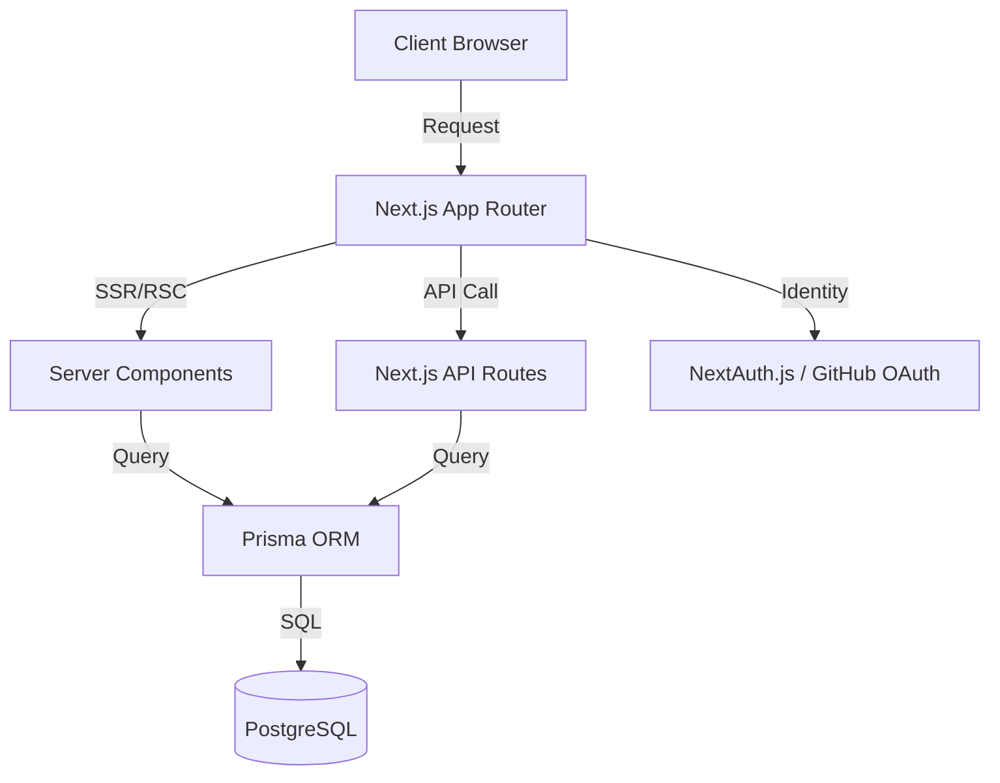

<div align="center">

# 🚀 LeadFlow

**The High-Performance CRM for Modern Sales Pipelines**

<p align="center">
  <a href="https://github.com/Mllkmoha/LeadFlow/blob/main/README.md"><b>Documentation</b></a> •
  <a href="https://github.com/Mllkmoha/LeadFlow/issues"><b>Report Bug</b></a> •
  <a href="https://github.com/Mllkmoha/LeadFlow/pulls"><b>Request Feature</b></a>
</p>

[](https://nextjs.org/)
[](https://www.typescriptlang.org/)
[](https://www.postgresql.org/)
[](https://www.prisma.io/)
[](https://tailwindcss.com/)

<br />

**LeadFlow** is a production-grade CRM designed to eliminate the chaos of lead management. Built with a focus on speed, type-safety, and an elite user experience, it transforms the way you track customer journeys from discovery to conversion.

</div>

---

## 📈 Performance Benchmarks

Unlike most portfolio projects, LeadFlow is engineered for speed. Verified via **Google Lighthouse** on a production build:

| Metric | Score | Status |
| :--- | :---: | :--- |
| **Performance** | **96** | 🟢 Elite |
| **Accessibility** | **100** | 🟢 Perfect |
| **Best Practices** | **100** | 🟢 Perfect |
| **SEO** | **100** | 🟢 Perfect |

**Core Web Vitals:**
- **LCP**: 0.6s (Fastest possible feel)
- **TBT**: 90ms (Zero lag interactions)
- **CLS**: 0 (Pixel-perfect stability)

---

## 🖼️ Project Preview

<!-- 
  👉 ACTION: Replace these with actual screenshots for maximum impact
-->
<div align="center">
  <div style="display: grid; grid-template-columns: 1fr 1fr; gap: 20px;">
    <div style="border: 1px solid #ddd; border-radius: 10px; padding: 10px; text-align: center;">
      <p><i>Dashboard & Analytics</i></p>
      <code><!-- Add Dashboard Screenshot Here --></code>
    </div>
    <div style="border: 1px solid #ddd; border-radius: 10px; padding: 10px; text-align: center;">
      <p><i>Visual Sales Pipeline</i></p>
      <code><!-- Add Pipeline Screenshot Here --></code>
    </div>
  </div>
</div>

---

## 🎯 The Solution

Most CRMs are either too simple (spreadsheets) or too bloated (Enterprise software). **LeadFlow** hits the sweet spot:

- **Centralized Intelligence**: Stop hunting for emails across threads. Every note and activity is linked to a single contact.
- **Visual Momentum**: The Kanban pipeline makes it immediately obvious where leads are stalling and where the wins are.
- **Zero-Latency UX**: By leveraging Next.js Server Components and TanStack Query, the app feels instantaneous.

## ✨ Professional Feature Set

| Feature | Engineering Implementation | Business Value |
| :--- | :--- | :--- |
| **Sales Pipeline** | Relational status tracking with Prisma `groupBy` | Visualize the sales funnel at a glance. |
| **Contact CRM** | Full CRUD with Zod-validated server actions | Maintain a clean, high-integrity lead database. |
| **Interaction Log** | One-to-many relationship: Contacts $\rightarrow$ Activities/Notes | Never forget a detail from a client call. |
| **Secure Auth** | GitHub OAuth $\rightarrow$ JWT Session $\rightarrow$ DB Sync | Enterprise-grade security with zero-friction login. |
| **Adaptive UI** | Tailwind 4 + shadcn/ui + Motion | Professional look that works on mobile and desktop. |

---

## 🏗️ Technical Architecture

### System Design
LeadFlow utilizes a **layered architecture** to ensure scalability and maintainability:



### Engineering Decisions
- **Server Components (RSC)**: Used for the majority of the app to reduce the JavaScript bundle sent to the client, resulting in the 96 Performance score.
- **Prisma Projection**: Instead of `findMany()`, I implement `select` blocks to fetch only necessary columns, reducing database I/O.
- **Zod Validation**: Every entry point (API/Form) is guarded by Zod schemas to prevent data corruption.
- **Optimistic Updates**: Leverages TanStack Query to make the UI feel instant even before the database confirms the change.

---

## 📂 Repository Blueprint

```text
src/
├── app/                    # Routing & Layouts (App Router)
│   ├── (auth)/             # Identity Management
│   ├── (dashboard)/       # Core Product Logic
│   └── api/                # Type-safe REST Endpoints
├── components/             # Atomic Design System
│   ├── ui/                 # Base Primitives (Shadcn)
│   ├── pipeline/           # Kanban Logic
│   └── contacts/           # CRM View Logic
├── lib/                    # Infrastructure & Config
│   ├── prisma.ts           # Database Singleton
│   └── validations/       # Zod Data Contracts
├── services/               # Business Logic Layer
└── auth.ts                 # OAuth Configuration
```

---

## 🚀 Setup & Deployment

### Local Environment
1. **Clone & Install**
   ```bash
   git clone https://github.com/Mllkmoha/LeadFlow.git
   cd LeadFlow/app
   npm install
   ```

2. **Configure `.env`**
   ```env
   DATABASE_URL="postgresql://..."
   AUTH_SECRET="your_secret"
   AUTH_GITHUB_ID="your_id"
   AUTH_GITHUB_SECRET="your_secret"
   ```

3. **Sync Database**
   ```bash
   npx prisma db push
   ```

4. **Launch**
   ```bash
   npm run dev
   ```

---

## 📈 Roadmap

- [ ] **Automated Follow-ups**: System-generated reminders for overdue activities.
- [ ] **Advanced Reporting**: Conversion rate analytics and lead-velocity tracking.
- [ ] **CSV Engine**: Bulk import/export for enterprise data migration.

---

## 👨‍💻 The Engineer

**Mohamed Rafik Mellouk**
*Junior Full-Stack Web Developer*

I specialize in building high-performance, type-safe web applications. LeadFlow is a testament to my commitment to **performance engineering**, **accessibility**, and **clean architecture**.

[](https://github.com/Mllkmoha)
[](https://linkedin.com/in/mohamed-mellouk-a9114233a)
[](https://mohamed-portfolio-b2d.pages.dev/)
